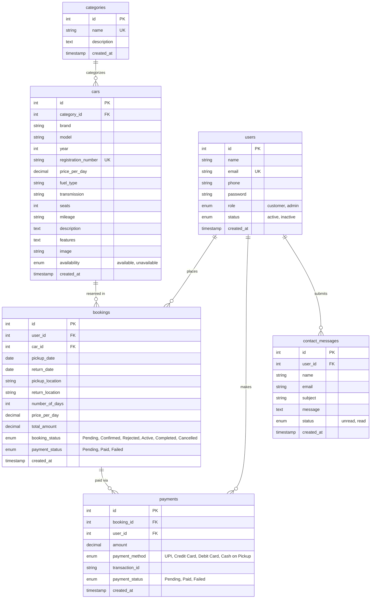

# DriveEasy – Car Rental Service Portal

A complete, modern, responsive full-stack **Car Rental Service Portal** developed with **PHP 8, MySQL, HTML5, CSS3, Vanilla JavaScript, and Bootstrap 5**. Designed specifically for easy local deployment on **XAMPP** (Apache + MySQL + phpMyAdmin) and structured for effortless presentation during college project vivas.

---

## 🚗 Table of Contents
1. [Project Overview](#project-overview)
2. [Key Features](#key-features)
   - [Customer Experience](#customer-experience)
   - [Admin Control Console](#admin-control-console)
   - [Booking & Overlap Prevention Logic](#booking--overlap-prevention-logic)
3. [Technology Stack](#technology-stack)
4. [Project Directory Structure](#project-directory-structure)
5. [Database Architecture & Relationships](#database-architecture--relationships)
6. [XAMPP Installation & Setup Guide](#xampp-installation--setup-guide)
7. [Demo Accounts (Viva Credentials)](#demo-accounts-viva-credentials)
8. [Security Implementations](#security-implementations)
9. [College Viva Q&A Guide](#college-viva-qa-guide)

---

## 1. Project Overview

**DriveEasy** is a web-based self-drive and chauffeur car rental portal. It replaces cumbersome paper contracts and opaque rental deposits with an intuitive, automated digital portal. 

Customers can register, search and filter the fleet, inspect vehicle specifications, verify date availability, calculate rental fares in real-time, execute simulated payments, and manage reservations. Administrators have an isolated administrative dashboard with telemetry, car CRUD management, file upload validations, booking approvals, category management, and customer oversight.

---

## 2. Key Features

### Customer Experience
* **Authentication & Profile**:
  * Secure account registration with input validations (duplicate email check, phone number formatting, minimum password length).
  * Sign-in system with password show/hide toggle and session fixation regeneration.
  * Customer profile management (update name, phone, email) with immutable customer ID and role protections.
  * Password change mechanism verifying current password via `password_verify()` and hashing new passwords with Bcrypt.
* **Vehicle Discovery & Filtering**:
  * Live search across brand, model name, and category.
  * Multi-attribute filtering: Category (SUV, Sedan, Hatchback, Luxury, EV, Sports), Fuel type (Petrol, Diesel, EV, Hybrid), Transmission (Automatic, Manual), Seating capacity (4, 5, 7 seats), and Price range slider (Min/Max ₹).
  * Sorting: Newest cars, Price Low &rarr; High, Price High &rarr; Low, Brand A &rarr; Z.
* **Vehicle Details**:
  * High-resolution vehicle gallery, full technical specifications (engine, mileage, fuel, transmission, seats, plate number).
  * Feature badges (Air Conditioning, Bluetooth, GPS, ADAS, 360-degree cameras).
  * Real-time availability indicator badge (Available / Unavailable).
* **Booking & Fare Engine**:
  * Live Vanilla JS calculation of rental days and total amount on the booking form.
  * Server-side conflict detection preventing date overlaps for the same car.
  * Date validation (no past dates, return date &ge; pickup date, minimum 1-day rental).
* **Payment Simulation & Receipts**:
  * Simulated payment options: UPI (GPay/PhonePe), Credit Card, Debit Card, and Cash on Pickup.
  * Unique transaction ID generation (e.g., `TXN-UPI-XXXXXXXX`).
  * Print-friendly tax invoice / booking slip with clean `@media print` CSS.
* **Booking Management**:
  * View active, upcoming, and past reservations.
  * Search bookings by Booking ID.
  * Cancel eligible reservations with safety confirmation modals.

### Admin Control Console
* **Dedicated Admin Authentication**:
  * Guarded by `require_admin()` in `includes/admin-auth.php`.
  * Regular users attempting to access `/admin/` are met with an authentic **403 Access Denied** barrier.
* **Live Operational Dashboard**:
  * Database-driven metric counters: Total Cars, Available Fleet, Total Customers, Total Bookings, Pending Approvals, Active Rentals (On-Road), Completed Rentals, Cancelled Reservations, and Total Revenue.
  * Category distribution breakdown.
  * Recent reservations log with fast-action controls.
* **Fleet Management (CRUD)**:
  * **Add Car**: Comprehensive form with technical specs, amenities, and safe file upload (MIME validation, size limit &le; 4MB, unique randomized filename storage in `assets/images/cars/`).
  * **Edit Car**: Modify specs, change rates, toggle availability, and replace or preserve car photographs.
  * **Delete Car**: Safe deletion check that prevents deleting a vehicle if it currently has active, confirmed, or pending customer bookings.
* **Customer Management**:
  * Search customer registry by name, email, or telephone.
  * View trip history and lifetime spend.
  * Instant account activation / suspension toggle.
  * Passwords strictly hidden and protected.
* **Booking Management**:
  * Filter reservations by status (`Pending`, `Confirmed`, `Active`, `Completed`, `Cancelled`, `Rejected`).
  * One-click status transitions and payment reconciliations.
* **Category Management**:
  * Create, edit, and delete vehicle categories.
  * Relational constraint check prevents category deletion if cars are still assigned to it.
* **Inquiries & Helpdesk**:
  * Read customer inquiries submitted via `contact.php`.
  * Toggle read/unread status and delete resolved tickets.

---

## 3. Technology Stack

* **Frontend**: HTML5, CSS3, Vanilla JavaScript (ES6+), Bootstrap 5.3.3, Bootstrap Icons 1.11.3
* **Backend**: PHP 8.x (Vanilla PHP utilizing Object-Oriented PDO database abstraction)
* **Database**: MySQL / MariaDB (InnoDB engine with Foreign Key Constraints)
* **Local Server**: XAMPP (Apache HTTP Server + MySQL + phpMyAdmin)
* **Architecture**: MVC-inspired modular procedural architecture with centralized helpers and auth guards.

---

## 4. Project Directory Structure

```
DriveEasy/
│
├── index.php                   # Public Homepage & featured fleet
├── login.php                   # Customer & Admin sign-in
├── register.php                # Customer registration
├── logout.php                  # Session destruction
├── cars.php                    # Fleet catalog with search, multi-filter & sorting
├── car-details.php             # Full vehicle specs & amenities
├── booking.php                 # Booking reservation form with live date calculation
├── booking-confirmation.php    # Simulated payment gateway & confirmation slip
├── my-bookings.php             # Customer reservation history & cancellation
├── booking-details.php         # Printable booking invoice & slip
├── profile.php                 # Customer profile management
├── change-password.php         # Password change with Bcrypt hashing
├── contact.php                 # Support inquiry form
├── about.php                   # Mission, standards, and company info
├── 403.php                     # 403 Access Denied error page
├── 404.php                     # 404 Page Not Found error page
│
├── admin/                      # Isolated Admin Control Center
│   ├── login.php               # Dedicated administrative sign-in
│   ├── dashboard.php           # Telemetry metrics & recent activity
│   ├── cars.php                # Fleet table with availability toggles
│   ├── add-car.php             # Add new vehicle with image upload
│   ├── edit-car.php            # Edit vehicle specifications
│   ├── delete-car.php          # Safe vehicle deletion handler
│   ├── bookings.php            # Booking management & status transitions
│   ├── users.php               # Customer accounts & suspension toggles
│   ├── categories.php          # Category CRUD with relational safety
│   ├── messages.php            # Customer inquiries & ticket management
│   └── logout.php              # Admin logout handler
│
├── includes/                   # Reusable components & business logic
│   ├── db.php                  # PDO database connection with error handling
│   ├── functions.php           # Helper functions, formatters, date & overlap logic
│   ├── auth.php                # User session management & login guards
│   ├── admin-auth.php          # Administrator authorization guards (require_admin)
│   ├── header.php              # HTML head, Google Fonts, Bootstrap CSS
│   ├── navbar.php              # Responsive navigation with dark mode & auth states
│   ├── footer.php              # Site footer with contacts & links
│   └── sidebar.php             # Admin console sidebar navigation
│
├── assets/
│   ├── css/
│   │   └── style.css           # Custom styles, dark theme, and print invoice styles
│   ├── js/
│   │   └── script.js           # Live calculation, dark mode, password toggle, previews
│   └── images/
│       ├── logo.svg            # DriveEasy vector emblem
│       └── cars/               # Vehicle photography & uploads
│
├── database/
│   └── car_rental.sql          # SQL schema & complete sample data import
│
└── README.md                   # Complete documentation & viva guide
```

---

## 5. Database Architecture & Relationships

### Database Name: `car_rental`



---

## 6. XAMPP Installation & Setup Guide

Follow these simple steps to run DriveEasy locally in XAMPP:

### Step 1: Start XAMPP Services
1. Launch the **XAMPP Control Panel**.
2. Click **Start** for both **Apache** and **MySQL**.
3. Verify both modules display green indicators with active ports (Apache: `80, 443`, MySQL: `3306`).

### Step 2: Copy Project Files to `htdocs`
1. Navigate to your XAMPP installation directory (default is `C:\xampp\htdocs\`).
2. Copy the project folder into `htdocs` and name it `DriveEasy` (or leave it in your current workspace directory):
   ```
   C:\xampp\htdocs\DriveEasy\
   ```

### Step 3: Import the Database
1. Open your web browser and navigate to:
   ```
   http://localhost/phpmyadmin/
   ```
2. Click **New** in the left sidebar.
3. Enter database name: `car_rental` and choose collation `utf8mb4_unicode_ci` (or click **Create**).
4. Select the newly created `car_rental` database.
5. Click the **Import** tab at the top.
6. Click **Choose File** and select:
   ```
   database/car_rental.sql
   ```
7. Scroll to the bottom and click **Import** (or **Go**). All 6 tables, keys, and sample data will be created instantly.

### Step 4: Open DriveEasy in Your Browser
Visit the portal at:
```
http://localhost/DriveEasy/
```
*(Or `http://localhost:8000/` if using PHP's built-in server `php -S localhost:8000`).*

---

## 7. Demo Accounts (Viva Credentials)

Use these pre-configured demonstration accounts for viva testing:

| Role | Email Address | Password | Privileges |
| :--- | :--- | :--- | :--- |
| **Administrator** | `admin@driveeasy.com` | `admin123` | Full Admin Console, CRUD, Telemetry, Approvals |
| **Customer #1** | `customer@driveeasy.com` | `customer123` | Active renter account with booking history |
| **Customer #2** | `priya@example.com` | `customer123` | Secondary customer for multi-user booking tests |

*Note: New customers can also be registered in seconds via `register.php`.*

---

## 8. Security Implementations

1. **SQL Injection Defense**: Every dynamic database query uses PDO prepared statements with parameterized inputs (`$stmt->prepare()` and `$stmt->execute([...])`). Raw user variables are never concatenated into SQL strings.
2. **Password Cryptography**: Passwords are never stored in plain text. They are hashed using PHP's standard `password_hash($pass, PASSWORD_DEFAULT)` which employs adaptive Bcrypt hashing, and verified using timing-attack-resistant `password_verify()`.
3. **Cross-Site Scripting (XSS) Mitigation**: All dynamic user-submitted content output into HTML is escaped using `htmlspecialchars(..., ENT_QUOTES, 'UTF-8')`.
4. **Access Control & Authorization**:
   - `require_login()` blocks unauthenticated guests from booking, profile, or reservation pages.
   - `require_admin()` enforces administrative checks on every page under `/admin/` and terminates unauthorized sessions with HTTP 403.
   - Booking ownership verification: A customer cannot tamper with or inspect another customer's booking by simply altering `?id=` in the URL.
5. **Safe File Uploads**: Uploaded vehicle images are verified against strict whitelist extensions (`jpg`, `jpeg`, `png`, `webp`, `svg`), file size limits (&le; 4MB), and assigned unique random identifiers (`uniqid()`) to prevent directory traversal or remote code execution.

---

## 9. College Viva Q&A Guide

### Q1: How did you implement booking date overlap prevention?
**Answer**:
A date overlap occurs when an existing booking overlaps with the requested rental range for the same car. We use the mathematical interval overlap formula:
$$\text{Existing Pickup} \le \text{Requested Return} \quad \text{AND} \quad \text{Existing Return} \ge \text{Requested Pickup}$$
In PHP/MySQL, we execute:
```sql
SELECT COUNT(*) FROM bookings 
WHERE car_id = :car_id 
  AND booking_status NOT IN ('Cancelled', 'Rejected')
  AND (pickup_date <= :return_date AND return_date >= :pickup_date)
```
If the count is greater than zero, the server rejects the reservation and alerts the customer to select alternate dates.

### Q2: Why did you choose PDO over MySQLi?
**Answer**:
PDO (PHP Data Objects) offers consistent database abstraction, supports named parameters, provides robust exception-handling modes (`PDO::ERRMODE_EXCEPTION`), and is industry standard for secure PHP applications.

### Q3: How do you protect user passwords?
**Answer**:
We use PHP's `password_hash()` with `PASSWORD_DEFAULT` (Bcrypt with automatic salt generation). When users sign in, `password_verify()` securely checks the candidate password against the stored hash in constant time to prevent timing attacks.

### Q4: How is responsive design achieved without heavy frontend frameworks?
**Answer**:
We utilize Bootstrap 5's responsive 12-column flexbox grid alongside a custom stylesheet (`assets/css/style.css`). We employ media queries (`@media (max-width: 991.98px)`) for the collapsible admin sidebar, adaptive table wrapping, and `@media print` for print-friendly invoice generation.

### Q5: How does the application handle portability across different XAMPP subfolders?
**Answer**:
We developed a dynamic `base_url($path)` helper in `includes/functions.php` that analyzes `$_SERVER['SCRIPT_NAME']`. Whether the project is placed in `htdocs/DriveEasy`, `htdocs/car_rental`, or run directly from root via `php -S localhost:8000`, all asset and page hyperlinks resolve automatically without manual config adjustments.
